  

# 🌐 Awesome Automated Web Browser Testing

  
  
  
  
  
  

> 🚀 **The definitive curated directory and market landscape for automated web browser testing, end-to-end (E2E) testing frameworks, AI test agents, cloud execution grids, and cross-browser testing SaaS platforms.**

Whether you are designing a high-throughput enterprise continuous testing CI/CD pipeline, orchestrating distributed Selenium/Playwright execution in Kubernetes, or comparing the total cost of ownership across major cloud device providers, this repository provides verified data, transparent pricing, and comprehensive ecosystem benchmarks.

---

## 📑 Table of Contents

- [📊 Sector Overview & Market Dynamics](#-sector-overview--market-dynamics)
- [☁️ SaaS Web & Browser Testing Clouds](#️-saas-web--browser-testing-clouds)
- [🛠️ Open-Source Frameworks & Tools](#️-open-source-frameworks--tools)
- [🏗️ Open-Core & Self-Hosted Infrastructure](#️-open-core--self-hosted-infrastructure)
- [📈 Star History](#-star-history)
- [💖 Support & Contributing](#-support--contributing)

---

## 📊 Sector Overview & Market Dynamics

The global automated software testing market is currently valued at approximately **$40B–$43B** and is projected to surpass **$80B–$100B+** by the mid-2030s, expanding at a compound annual growth rate (CAGR) of 10%–15%. Driven by the shift toward shift-left testing, continuous integration/continuous delivery (CI/CD), and AI-driven autonomous agent authoring, test automation has become a core operational requirement rather than an optional QA milestone.

Despite the emergence of multi-billion-dollar category giants like BrowserStack, the sector remains **moderately to highly fragmented** rather than a winner-take-all monopoly. Because modern engineering teams maintain diverse polyglot stacks (web, native mobile, responsive viewports, and APIs) and distinct deployment architectures (ephemeral Kubernetes clusters vs. compliance-sensitive on-premise grids), specialized vendors and open-source frameworks thrive side-by-side. Commercial platforms increasingly compete by orchestrating and scaling around standardized open protocols (WebDriver, Chrome DevTools Protocol, and BiDi) while bundling proprietary AI visual regression, smart flaky-test triage, and access to thousands of real desktop and mobile device configurations.

---

## ☁️ SaaS Web & Browser Testing Clouds

Cloud-hosted cross-browser and real-device testing platforms. The table below is sorted by **Company Size / Valuation / Estimated Annual Revenue** (descending), featuring verified starting tiers and explicit free tier / trial limitations:

| Platform | Company Size (Valuation / ARR) | Pricing Model | Starting Tier Price | Free Tier / Trial Plan Limits | Core Capabilities & Description |
|---|---|---|---|---|---|
| [BrowserStack](https://www.browserstack.com/) | **$4.0B Valuation** (~$225M–$230M ARR) | Per parallel session | Desktop: $29/mo; Desktop + Mobile: $39/mo; Automate: $199/parallel/mo | **Free Trial Only**: Limited to 30 minutes of Live interactive testing, 100 minutes of Automate, and 100 screenshots. No permanent free tier. | Industry benchmark cloud grid delivering instant access to 3,000+ real desktop browsers and mobile devices with zero maintenance. |
| [Sauce Labs](https://saucelabs.com/) | **~$500M–$613M Valuation** (~$90M–$100M ARR) | Per parallel session | Live Testing: $39/mo; Virtual Device Cloud: $149/mo; Real Device: $199/mo | **Free Trial Only**: 28-day free trial including 1 parallel session, 100 automated minutes, 50 virtual device minutes, and 50 live testing minutes. No permanent free tier. | Enterprise-grade continuous testing and digital quality platform offering scalable automated browser and real-device execution. |
| [TestMu AI (LambdaTest)](https://www.lambdatest.com/) | **~$400M Valuation** (~$25M–$30M ARR) | Per parallel session | Live Testing: $15/mo; Desktop Automation: $79/mo; Real Device Plus: $199/mo | **Free Forever Tier**: 60 minutes/month of live interactive browser testing, 1 concurrent session, 10 minutes per test session, and 10 responsive tests. | Unified AI-accelerated testing cloud with HyperExecute high-speed test orchestration, KaneAI test agents, and cross-browser grids. |
| [Cypress Cloud](https://www.cypress.io/cloud) | **~$255M Valuation** (~$18M–$20M ARR) | Per test result | Team: $75/mo (includes 10,000 monthly test results) | **Free Forever Tier**: 500 test results/month, up to 3 user seats, flaky test management, and public/private repo support. | Cloud test orchestration and analytics engine for Cypress, featuring smart test prioritization, parallelization, and flake detection. |
| [Katalon](https://katalon.com/) | **~$120M–$150M Est. Valuation** (~$40M–$60M ARR) | Per seat / per execution | True Platform: $59/seat/mo; Studio Enterprise: $229/seat/mo | **Free Forever Tier**: Includes Katalon Studio with 2,000 monthly TestOps execution results and basic test authoring. 30-day trial for enterprise features. | Comprehensive AI-powered test authoring, execution, and quality analytics platform across web, mobile, API, and desktop environments. |
| [TestGrid](https://www.testgrid.io/) | **~$25M–$35M Est. Valuation** (~$5M ARR) | Per seat | Starter: $199/seat/mo (includes AI agents and parallel execution) | **Free Trial Only**: 15-day free trial with 200 real-device testing minutes and 1 parallel session. No permanent free tier. | End-to-end testing platform supporting codeless test authoring, dedicated real-device clouds, and autonomous AI testing agents. |

---

## 🛠️ Open-Source Frameworks & Tools

Curated open-source browser automation libraries, test runners, and grid orchestration engines. Sorted by **GitHub Stars_Count** (descending):

| Project | GitHub_Stars | License | Description |
|---|:---:|---|---|
| [Browser Use](https://github.com/browser-use/browser-use) |  | MIT | Open-source Python library for connecting AI agents directly to automated web browsers for intelligent navigation and scraping. |
| [Playwright](https://github.com/microsoft/playwright) |  | Apache-2.0 | Next-generation end-to-end testing and browser automation framework supporting Chromium, Firefox, and WebKit across Node.js, Python, Java, and .NET. |
| [Puppeteer](https://github.com/puppeteer/puppeteer) |  | Apache-2.0 | High-level Node.js API to programmatically control Chrome or Chromium over the Chrome DevTools Protocol (CDP). |
| [Cypress](https://github.com/cypress-io/cypress) |  | MIT | Developer-friendly, fast, and reliable testing framework executing directly inside the browser runtime with real-time reload. |
| [Selenium](https://github.com/SeleniumHQ/selenium) |  | Apache-2.0 | The foundational industry-standard browser automation framework powering W3C WebDriver standard compliance worldwide. |
| [Appium](https://github.com/appium/appium) |  | Apache-2.0 | Ecosystem-standard cross-platform automation framework for native, hybrid, and mobile web applications on iOS and Android. |
| [Nightwatch.js](https://github.com/nightwatchjs/nightwatch) |  | MIT | Integrated end-to-end testing and assertions framework written in Node.js using W3C WebDriver and Chrome DevTools protocols. |
| [TestCafe](https://github.com/DevExpress/testcafe) |  | MIT | Pure Node.js automated end-to-end web testing platform requiring zero browser plugins or external WebDriver binaries. |
| [WebdriverIO](https://github.com/webdriverio/webdriverio) |  | MIT | Progressive, extensible next-gen test automation framework for modern web and mobile apps supporting WebDriver and DevTools protocols. |
| [Docker Selenium](https://github.com/SeleniumHQ/docker-selenium) |  | Apache-2.0 | Production-ready containerized images for running Selenium Grid hubs and nodes with Chrome, Firefox, and Edge. |
| [Selenium IDE](https://github.com/SeleniumHQ/selenium-ide) |  | Apache-2.0 | Open-source record-and-playback extension for Chrome and Firefox enabling rapid test case authoring and codeless automation. |
| [Selenoid](https://github.com/aerokube/selenoid) |  | Apache-2.0 | Ultra-fast, lightweight Golang-based implementation of Selenium Grid launching isolated browser sessions inside Docker containers. |

---

## 🏗️ Open-Core & Self-Hosted Infrastructure

Hybrid and open-core solutions for teams deploying private test infrastructure or seeking self-hosted enterprise runners:

| Platform | GitHub_Stars | License | Pricing | Free Tier / Trial Plan Limits | Description |
|---|:---:|---|---|---|---|
| [Moon by Aerokube](https://github.com/aerokube/moon) |  | Apache-2.0 (Open-Core) | $5/parallel session/month | **Free Forever Tier**: Free for up to 4 parallel browser sessions in Kubernetes/OpenShift clusters without time limits. | Kubernetes-native scalable browser grid supporting Selenium, Playwright, Puppeteer, and Cypress with dynamic pod scheduling. |
| [Browserless](https://github.com/browserless/browserless) |  | Commercial / Source-Available | Cloud starting at $50/mo; Self-hosted enterprise licensing available | **Free Forever Tier**: Open-source Docker image free for personal/local self-hosting; Cloud plan offers 1,000 free sessions/month. | Scalable headless Chrome service optimized for high-volume automated browser tasks, web scraping, and QA workloads. |

---

## 📈 Star History

---

## 💖 Support & Contributing

Thank you for exploring **Awesome Automated Web Browser Testing**! If you find this curated list valuable for your QA architecture, benchmarking, or development workflow, please consider supporting the project:

- ⭐ **Star this repository** to help other engineers discover it.
- 🍴 **Fork the repo** to contribute new tools, update pricing tiers, or suggest benchmarks.
- 📢 **Share with your colleagues** on LinkedIn, X (Twitter), and developer communities.
- ☕ **Buy me a coffee / Sponsor**: If you'd like to support ongoing maintenance and new awesome lists, please consider sponsoring via the [GitHub Sponsors Dashboard](https://github.com/sponsors/ishandutta2007).
